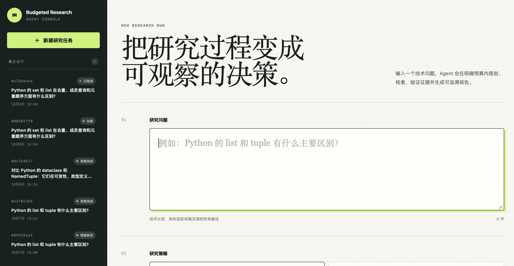
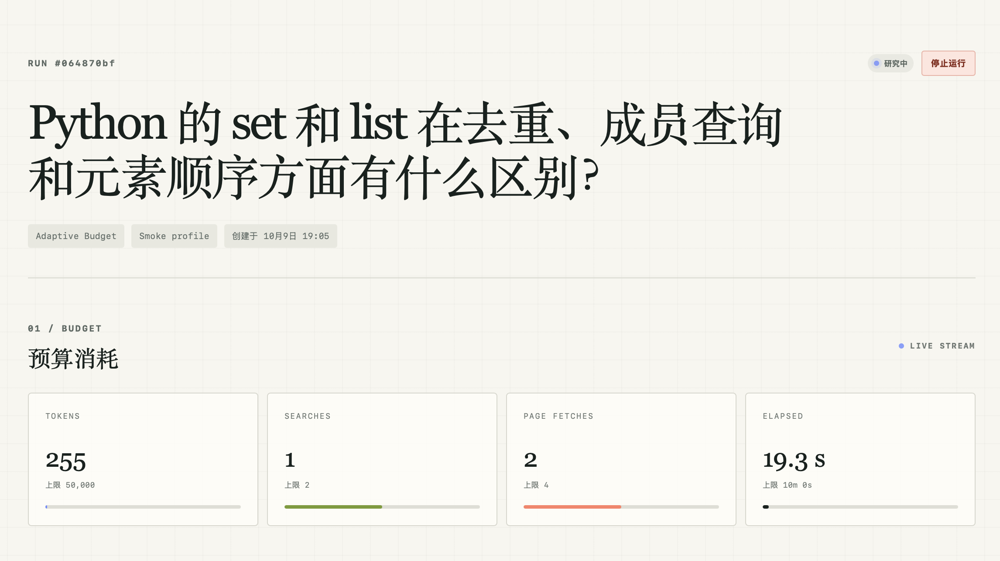
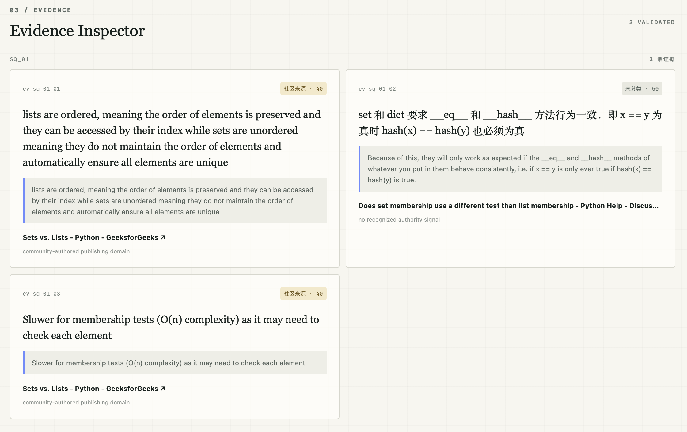
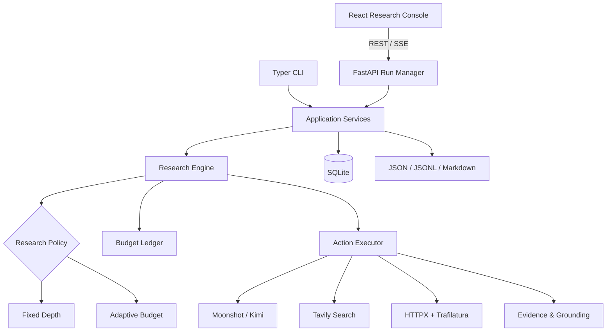
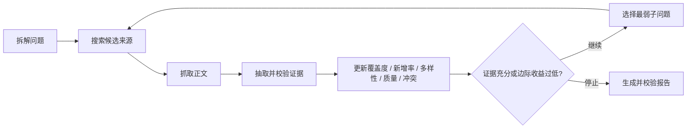

# Budgeted Research Agent

- **开发周期：** 于2026.09开始
- **当前状态：** 核心功能与离线评测已完成

面向技术调研任务的预算感知 Research Agent。系统把开放式研究建模为一组可解释的
状态与动作，在 Token、搜索、页面抓取、费用和时间上限内，自主拆解问题、检索网页、
抽取并校验证据，最后生成带可追溯引用的 Markdown 报告。

项目同时实现 `FixedDepthPolicy` 基线与 `AdaptiveBudgetPolicy`。两种策略复用同一组
Planner、Retriever、Evidence Extractor 和 Report Writer，通过成对实验观察研究质量、
资源消耗与稳定性之间的权衡。



## 项目解决什么问题

固定深度的 Research Agent 会给每个子问题分配相同的检索资源：简单分支可能被重复
研究，困难分支则可能在证据不足时提前停止。本项目让 Policy 根据当前证据状态与剩余
预算选择下一步动作：

- 为未探索的子问题建立最低证据基础；
- 优先补充低覆盖、低来源多样性、低来源质量或存在冲突的分支；
- 对重复、无法逐字回溯或来源无效的证据进行拒绝；
- 在达到证据阈值、边际新增率过低或需要预留报告预算时停止；
- 将每次选择的原因、预计资源和实际消耗保存为可回放事件。

## 已实现能力

- **显式 Agent 状态机**：Policy、Action Executor、State Reducer 与 Budget Ledger 解耦；
- **双策略对照**：Fixed Depth 基线和基于证据状态的 Adaptive Budget 策略；
- **硬预算控制**：调用前预留、调用后结算 Token、费用、搜索、抓取和时间；
- **真实 Provider**：Moonshot/Kimi、Tavily、HTTPX 与 Trafilatura；
- **证据链**：网页正文分块、BM25 上下文选择、Evidence 去重、逐字支持片段校验；
- **来源评估**：根据官方文档、学术、政府、代码仓库和社区域名进行确定性分层；
- **Grounded Report**：报告主张必须绑定 Evidence ID，渲染前再次做确定性校验；
- **可观测性**：记录动作、原因、决策上下文、资源估算、实际消耗和停止条件；
- **持久化服务**：FastAPI、SQLite、后台任务、REST API 与 SSE 实时事件流；
- **研究控制台**：创建任务、浏览历史、实时预算、行动轨迹、证据与报告；
- **安全取消**：用户可以停止运行，并保留取消前已经产生的资源记录；
- **评测框架**：版本化任务集、Fixed/Adaptive 成对运行、重复实验和波动统计。





## 系统架构



详细模块边界、运行时序和状态流转见 [系统架构](docs/architecture.md)。

## Adaptive 决策闭环



Policy 只读取 `ResearchState` 并输出下一条 `Action`。外部调用、状态更新、预算结算与
事件持久化分别由独立模块负责，便于离线测试、基线对照和策略替换。

## 技术栈

| 层 | 技术 |
|---|---|
| Agent Core | Python 3.11、Pydantic v2、自研异步状态循环 |
| LLM / Search | Moonshot OpenAI-compatible API、Tavily |
| Retrieval | HTTPX、Trafilatura、BM25、确定性文本分块 |
| API / Storage | FastAPI、SSE、SQLAlchemy、SQLite |
| Frontend | React 19、TypeScript、Vite、TanStack Query、Tailwind CSS |
| Tooling | uv、pytest、Vitest、npm |

## 快速启动

### 1. 配置后端

```bash
cd backend
cp .env.example .env
```

至少填写：

```env
MOONSHOT_API_KEY=
MOONSHOT_MODEL=
TAVILY_API_KEY=
```

安装依赖并启动：

```bash
uv sync --extra dev
uv run bra serve --reload
```

健康检查：

```bash
curl http://127.0.0.1:8000/api/v1/health
```

### 2. 启动前端

在另一个终端执行：

```bash
cd frontend
npm install
npm run dev
```

打开 `http://127.0.0.1:5173`。前端默认连接
`http://127.0.0.1:8000/api/v1`，也可以通过 `frontend/.env` 中的
`VITE_API_BASE_URL` 覆盖。

## 使用方式

Web 控制台提供两种运行档位：

- `Smoke`：单子问题、小规模来源与证据上限，适合低成本验证完整链路；
- `Standard`：四个候选子问题和更完整的证据目标，适合正式技术调研。

也可以直接使用 CLI：

```bash
cd backend
uv run bra providers-check
uv run bra research "Python 的 dataclass 和 NamedTuple 有什么主要区别？" \
  --policy adaptive \
  --smoke \
  --max-tokens 50000 \
  --max-searches 2 \
  --max-page-fetches 4 \
  --max-seconds 600
```

完全离线的确定性闭环：

```bash
uv run bra offline-demo
```

## 测试与构建

后端测试覆盖预算账本、策略、Evidence 指标、Report Grounding、存储、API、后台任务、
CLI 和离线集成链路：

```bash
cd backend
uv run pytest
```

前端测试与生产构建：

```bash
cd frontend
npm run test
npm run build
```

真实 Provider 检查和评测会产生外部 API 消耗，不包含在默认离线测试中。

## 评测

开发任务集位于 `backend/evals/dev-suite.json`。单任务成对检查：

```bash
cd backend
uv run bra eval run --suite evals/dev-suite.json --limit 1
```

完整的 10 任务、两策略单次成对实验：

```bash
uv run bra eval run --suite evals/dev-suite.json --repetitions 1
```

评测汇总会同时输出 Token、搜索、页面抓取、耗时、完成率、失败率、Coverage、来源
多样性、来源质量及每 10,000 Token 的 Coverage。最新多场景评测的成功配对任务中，
Adaptive 将 Coverage 从 `0.897` 提升至 `1.000`、来源多样性从 `0.828` 提升至 `1.000`，
并减少 `17.6%` 页面抓取；代价是 Token 增加 `37.5%`、耗时增加 `13.6%`。这些指标是
内部证据代理而非事实正确率，准确数据和适用边界见
[现有评测结果](docs/evaluation-results.md)。

## 运行产物

每次研究会同时写入 SQLite，并生成可独立检查的目录：

```text
backend/runs/{run_id}/
├── request.json
├── state-final.json
├── summary.json
├── evidence.json
├── metrics.json
├── claim-clusters.json
├── usage.json
├── events.jsonl
└── report.md
```

## 项目结构

```text
backend/    Agent Core、Provider、CLI、API、SQLite、评测与测试
frontend/   React 研究控制台
docs/       产品定义、架构、策略、证据、评测与求职材料
```

## 文档

- [项目章程与 V1 边界](docs/project-charter.md)
- [系统架构与运行时序](docs/architecture.md)
- [Fixed Depth Baseline](docs/fixed-depth-baseline.md)
- [Adaptive Budget Policy](docs/budget-policy.md)
- [Report Grounding](docs/report-grounding.md)
- [评测协议](docs/evaluation.md)
- [现有评测结果](docs/evaluation-results.md)
- [演示与截图清单](docs/demo-guide.md)
- [简历与面试讲解材料](docs/resume-and-interview.md)
- [V1 发布检查表](docs/v1-release-checklist.md)

## V1 边界

V1 聚焦公开网页技术调研和预算决策，不包含账号权限、企业私有知识库、多模态文档、
分布式任务队列或学习型策略。SQLite 与进程内后台任务适合本地演示和单实例部署；生产
多实例环境需要外部数据库、任务队列和分布式事件通道。
