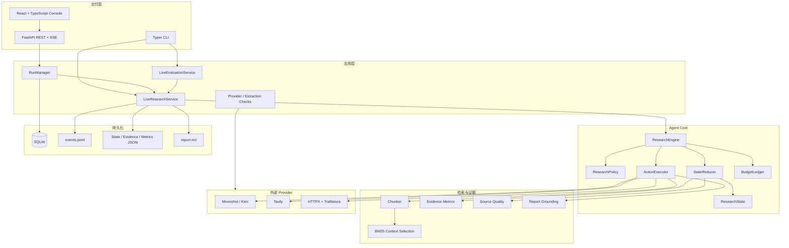
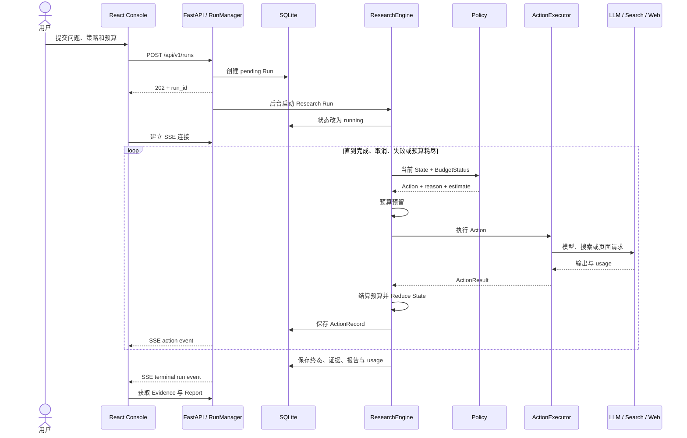
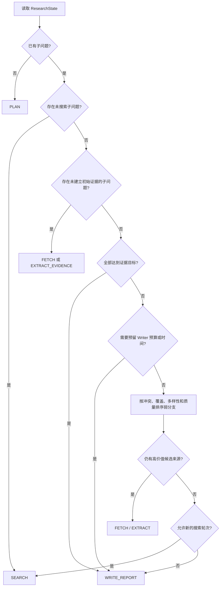
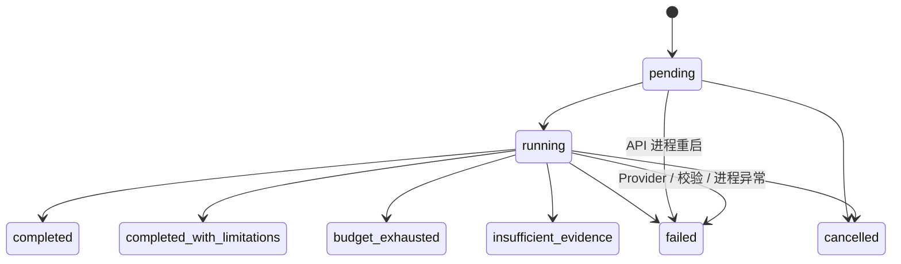

# 系统架构与运行时序

> 状态：V1 implemented  
> 目的：说明模块边界、核心状态、一次研究的执行路径，以及当前单实例交付边界。

## 1. 总体架构

## 2. 核心职责

| 模块 | 输入 | 输出 | 不负责 |
|---|---|---|---|
| `ResearchPolicy` | 只读研究状态与剩余预算 | 下一条 Action 或停止 | 网络调用、数据库写入 |
| `ActionExecutor` | Action 与当前状态 | ActionResult 和真实资源消耗 | 决定下一步、修改全局状态 |
| `StateReducer` | State、Action、Result | 新的 ResearchState | 调用 Provider、预算判断 |
| `BudgetLedger` | 资源估算与实际使用量 | 预算快照、超限拒绝 | 研究质量判断 |
| Evidence 模块 | 来源、Chunk、Evidence | 去重证据、指标、质量层级 | 决定研究动作 |
| Grounding 模块 | 报告草稿与 Evidence ID | 通过校验的结构化报告 | 自由补充无证据事实 |
| `RunManager` | API 创建/取消请求 | 后台任务与持久化状态 | Agent 策略逻辑 |

这种拆分让 Fixed 与 Adaptive 只替换 Policy，其他组件保持一致，从而减少评测中的混杂变量。

## 3. 一次研究的时序

## 4. Adaptive Budget 决策

Adaptive V1 是确定性规则策略，没有额外调用策略 LLM。它读取以下信号：

- `coverage`：Claim Cluster 覆盖与来源多样性的组合；
- `novelty`：新 Claim Cluster 和新来源比例；
- `source_diversity`：唯一来源数相对目标值；
- `source_quality_score`：唯一来源的平均质量；
- `conflict_ratio`：相近但极性相反的 Claim 比例；
- `low_novelty_streak`：连续低新增轮数；
- Token、搜索、页面抓取和剩余时间。

## 5. 证据与报告约束

Evidence 并非模型返回什么就保存什么。系统执行以下检查：

1. Evidence 必须引用本次抓取并进入上下文的来源；
2. `support_span` 必须能在来源正文中回溯；
3. 同来源重复片段、近似 Claim 和重叠支持片段不会重复增加 Coverage；
4. 不同来源的近似 Claim 会进入同一个 Claim Cluster，但保留各自 Evidence；
5. Report assertion 必须绑定存在的 Evidence ID；
6. 渲染前会再次验证 assertion 与证据 Claim 的一致性；
7. 无证据章节会明确标记证据不足。

## 6. 持久化与实时更新

SQLite 是 API 的运行时事实来源，保存 Run、Action、Evidence、Report 和 Usage。每次完整
运行还会生成 JSON、JSONL 与 Markdown 文件，便于不依赖数据库进行审计。

前端在打开活动任务时连接 `/events/stream`：

- `run` 事件更新状态；
- `action` 事件增量更新 Timeline 和实时资源统计；
- 浏览器断线后使用 `Last-Event-ID` 继续读取遗漏事件；
- 终态到达后关闭流并读取 Evidence 与 Report。

取消运行会取消进程内异步任务，将状态保存为 `cancelled`，并从已保存 Action 中汇总取消前
的实际资源。正在执行的单个外部请求可能已经计费，但不会继续安排后续动作。

## 7. 运行状态

## 8. 当前部署边界

V1 面向本地演示和单实例运行：

- SQLite 无需独立数据库服务；
- RunManager 使用 API 进程内任务；
- API 重启会把未完成任务标记为失败，避免产生永远处于 running 的记录；
- SSE 从 SQLite 回放持久化事件。

多实例或生产部署需要把进程内任务迁移到外部队列，并使用 PostgreSQL 与共享事件通道。
这些能力不属于当前 V1。
